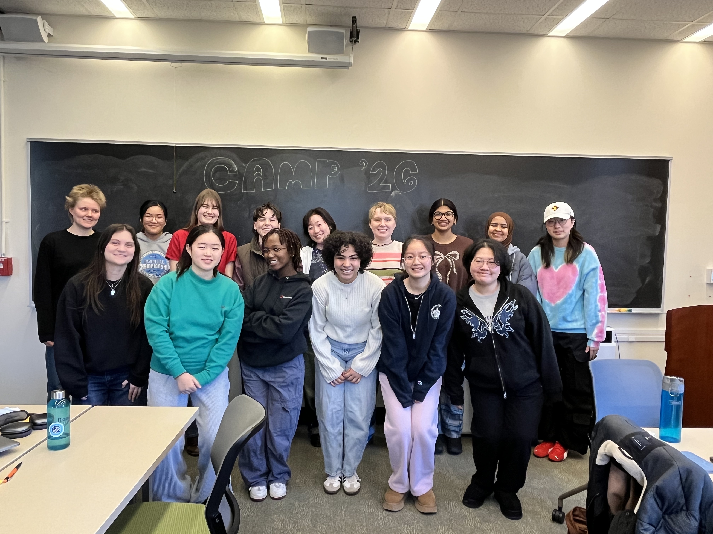
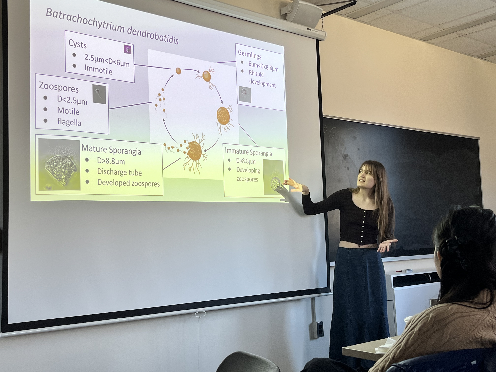
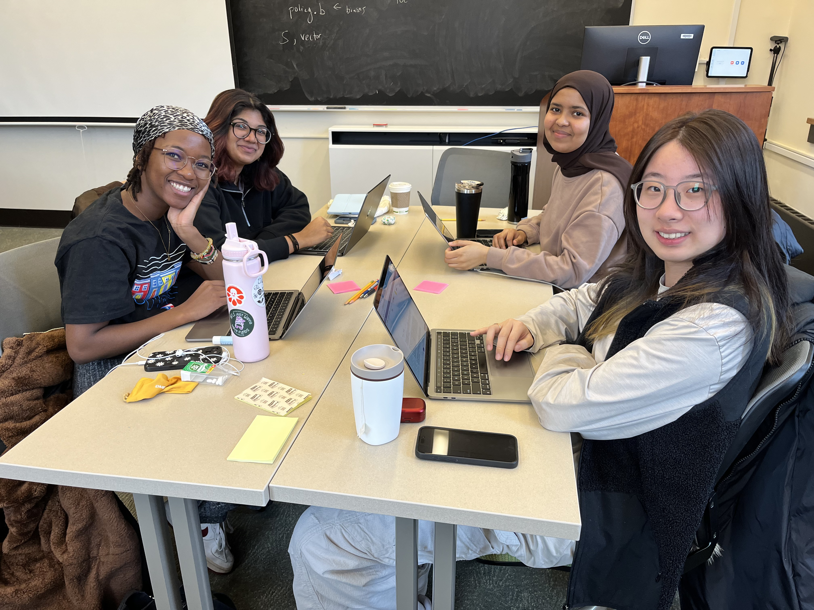
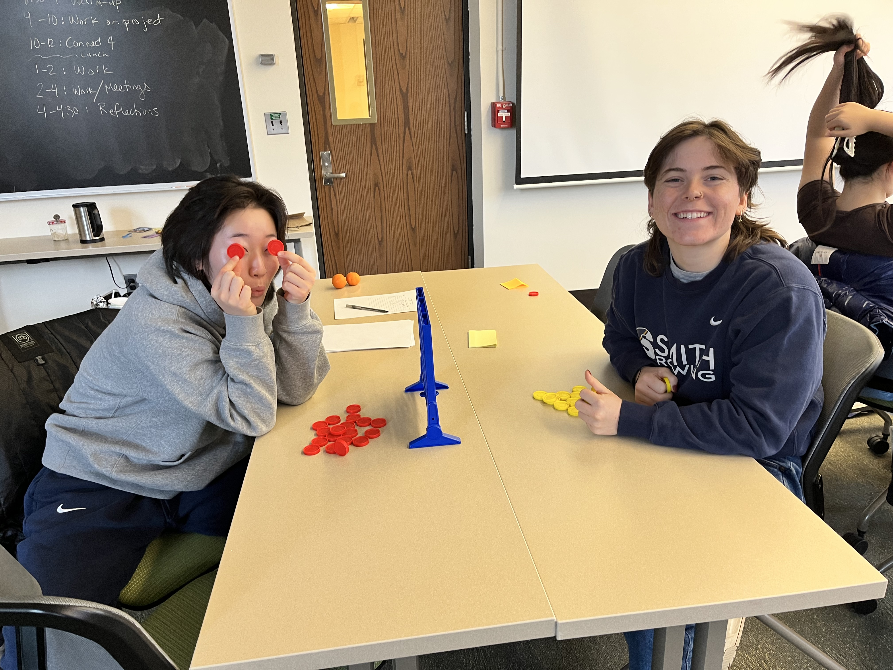
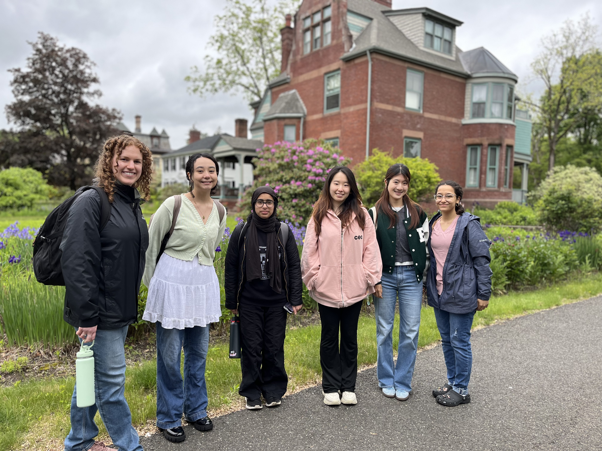

---
title: "CAMP"
subtitle: "Computational and Applied Mathematics Practicum"
toc: false
---

CAMP is an intensive introduction to research in computational and applied mathematics at Smith College. The program gives undergraduate students an opportunity to explore mathematical research, develop computational skills, and experience what it means to work on an open-ended problem.

**No prior research experience is required.** Students learn by doing: experimenting with computational methods, developing questions, discussing ideas, and communicating their progress.

::: {.camp-lead-photo}

{alt="Students participating in CAMP 2026"}

*The January 2026 CAMP cohort.*

:::

## Learning how to do research

CAMP combines short lessons in computational mathematics with substantial time for independent exploration. Students learn to use tools such as MATLAB while developing the less formal skills that research requires: formulating questions, troubleshooting, documenting progress, working collaboratively, and communicating results.

Rather than aiming for a polished research result in two weeks, the program emphasizes learning how to begin and sustain a research investigation.

::: {.camp-gallery}

{alt="A student presenting a research project during CAMP"}

{alt="CAMP students working together on computational projects"}

{alt="Students exploring a mathematical game during CAMP"}

:::

*Presentations, collaborative computing, and hands-on exploration during CAMP 2026.*

## From pilot program to Smith course

CAMP began as a pilot program in May 2025 with five students. A second offering in January 2026 expanded to fifteen students.

Building on these experiences, CAMP has been approved as **MTH 263**, a two-credit Smith College January-term course, beginning in January 2027.

The course offers students a structured but exploratory introduction to computational research, with opportunities to pursue questions suited to their interests and preparation.

The CAMP pilots and the development of the teaching resources were supported by the **Richard Lounsbery Foundation**.

::: {.camp-history-photo}

{alt="Participants in the May 2025 CAMP pilot"}

*The inaugural CAMP cohort, May 2025.*

:::

## Resources for instructors

CAMP was designed to be adaptable. Instructors interested in offering a similar program can use the practical replication guide and companion teaching materials.

The materials include sample schedules and syllabi, MATLAB activities, project-scoping exercises, student reflection templates, presentation prompts, and assessment resources.

::: {.camp-downloads}

### Practical Replication Guide

A short guide to organizing a CAMP-style program, including its structure, daily routines, and practical advice.

[Download the replication guide (PDF)](files/CAMP_Replication_Guide.pdf)

### Teaching Resource Package

Editable teaching materials, computational exercises, templates, and sample datasets.

[Download the teaching resources (ZIP)](files/CAMP_Teaching_Resources_Clean.zip)

:::

These materials are provided for adaptation to other instructional settings. Some were used during the 2025–2026 pilots; others were developed for subsequent offerings.

---

*Developed at Smith College with support from the Richard Lounsbery Foundation.*
