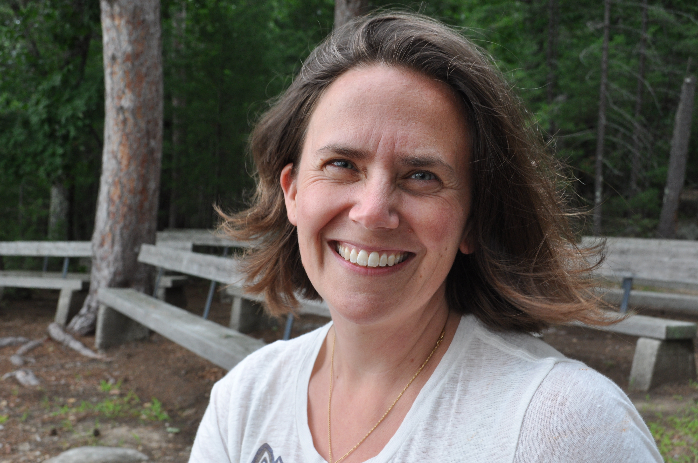
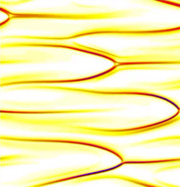
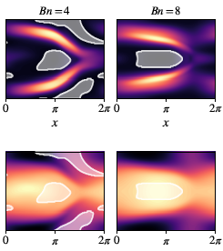
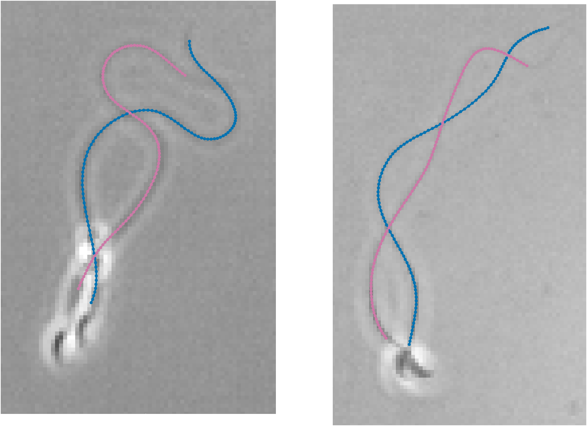
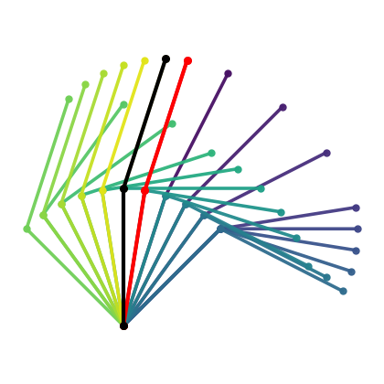

---
title: "Home"
title-block-banner: false
title-block-style: none
page-layout: full
---

::: {.hero-section}
::: {.hero-text}

APPLIED MATHEMATICS · SMITH COLLEGE

::: {.intro-identity}

{.profile-photo alt="Portrait of Becca Thomases"}

::: {.intro-name}

# Becca Thomases

**Professor of Mathematical Sciences**

:::
:::

I study the mathematics of fluid motion, with an emphasis on complex fluids, computational modeling, and nonlinear dynamics.

My research combines mathematical analysis and numerical simulation to explore how fluids flow, deform, and organize.

[Explore my research](research.qmd){.hero-link}

:::

::: {.hero-image-grid}

{alt="Structures in a viscoelastic fluid simulation"}

{alt="Elastoviscoplastic flow simulations"}

{alt="Experimental sperm flagellar shapes in Newtonian fluids"}

{alt="Reinforcement learning cilia stroke reconstructions"}

:::
:::

::: {.home-content}

## Research, teaching, and collaboration

My work spans complex fluid dynamics, computational mathematics, and mathematical approaches to understanding physical systems.

I also enjoy working with students on open-ended computational problems and developing opportunities for undergraduates to experience mathematical research.

[Research](research.qmd) · [Publications](publications.qmd) · [Students & Teaching](teaching.qmd) · [CAMP](camp.qmd)

:::
